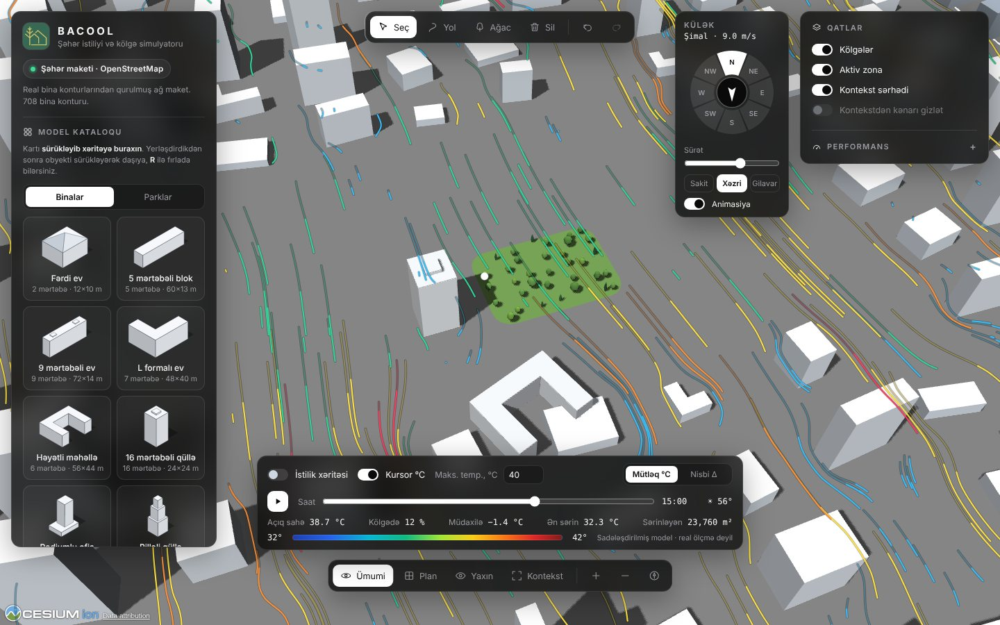
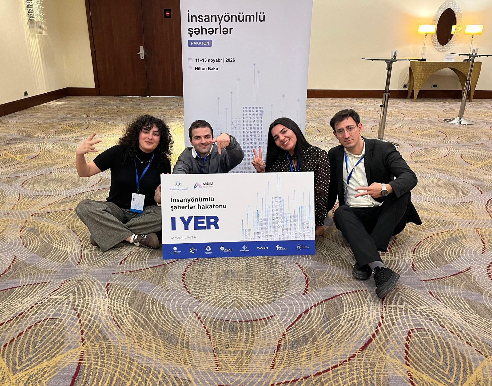
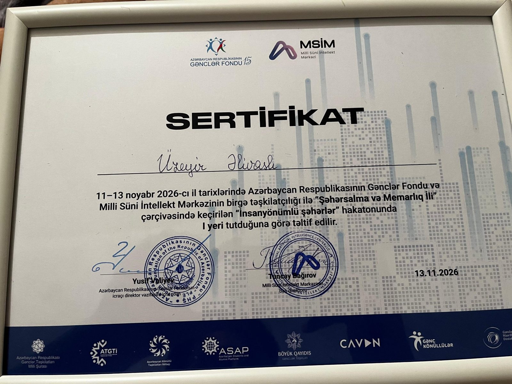
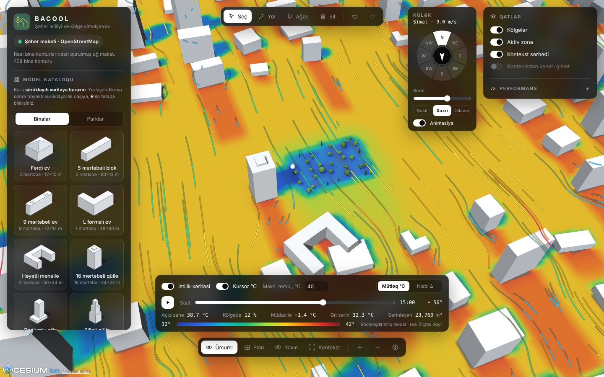
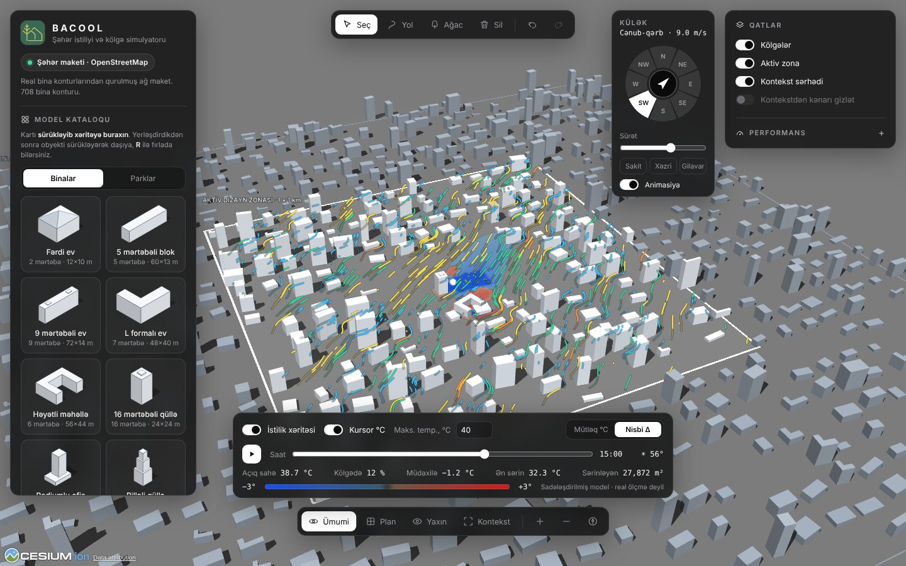

<div align="center">


# NeuraCity

### Test the city before you build it.

A 3D urban microclimate simulator for Baku: drop buildings and parks onto the map and instantly see how shade, heat and wind change around them.

🏆 **1st place — "Human-Centered Cities" Hackathon (İnsanyönümlü şəhərlər), Baku, 11–13 November 2026**


</div>

<p align="center">
  
</p>

---

## 🏆 First place at the "Human-Centered Cities" Hackathon

NeuraCity won **1st place** at the **"Human-Centered Cities" (İnsanyönümlü şəhərlər) hackathon**, held on **11–13 November 2026 at Hilton Baku**. The hackathon was co-organized by the **Youth Foundation of the Republic of Azerbaijan** and the **National Artificial Intelligence Center (MSİM)** as part of the **"Year of Urban Planning and Architecture"**, under the *Green City — Climate and Sustainable Environment* track.

We built the working prototype in a single day and presented it to the jury on the final day.

<table>
  <tr>
    <td width="50%"></td>
    <td width="50%"></td>
  </tr>
  <tr>
    <td align="center"><sub>The team with the 1st place award</sub></td>
    <td align="center"><sub>1st place certificate</sub></td>
  </tr>
</table>

---

## Why NeuraCity?

Since 2018, large construction projects in Azerbaijan must be assessed for their environmental impact. In practice, that impact is hard to **see**, design options are rarely **compared** side by side, and problems often surface only **after** a building is finished.

Baku is entering a major redevelopment period under its 2040 Master Plan. Every new tower, courtyard and park changes how hot, shaded and windy the streets around it will be. NeuraCity makes those changes visible **before** a decision is made — directly in the browser.

> Think of it as a flight simulator for urban planners: you "build" in the simulator first, then in the real city.

## What it does

<p align="center">
  
  
</p>
<p align="center"><sub>Left: absolute heat map with a park cooling its surroundings · Right: relative mode across the whole design zone</sub></p>

| | Feature | What you get |
|---|---|---|
| 🏙️ | **3D city model** | Real Baku building footprints from OpenStreetMap, in a 1 × 1 km active design zone |
| 🧱 | **Drag-and-drop catalog** | 9 building types and 6 park types, plus free-form buildings, parks, roads and trees |
| ☀️ | **Real-time shadows** | Sun position for every hour from 06:00 to 20:00; shadows from real and added buildings |
| 🌡️ | **Heat map** | 4 m resolution grid with a hover thermometer at any point |
| 🌬️ | **Wind** | 8 directions, 0–15 m/s, local presets for *Khazri* (north) and *Gilavar* (south), animated flow lines |
| 🧪 | **Facade materials** | Light plaster, limestone, concrete, brick, glass, green facade — each with its own reflectivity and heat storage |
| 🔁 | **Before → After** | See exactly what your design changes, e.g. **40.0 → 37.0 °C** after adding a park |

> The heat model is a simplified, physics-based demo model built for **comparing design options**. Its coefficients are estimates, not field measurements. Calibration against satellite data is the next step on our roadmap.

## Quick start

```bash
npm install
npm run dev        # http://localhost:5173
```

- `http://localhost:5173/` — landing page
- `http://localhost:5173/app.html` — the simulator

Requires **Node.js 20.19+**. No API key is needed: the app runs on a white city model built from OpenStreetMap data.

**Before a demo**, save the building data locally so the app works offline and avoids Overpass rate limits:

```bash
npm run snapshot   # creates public/data/osm-buildings.json
```

<details>
<summary><b>Optional map modes (API keys)</b></summary>

| Mode | Requirement | Look |
|---|---|---|
| White city model (OSM) | none | Extruded Overpass footprints — **recommended for demos** |
| OSM 3D Buildings (Cesium ion) | `VITE_CESIUM_ION_TOKEN` | Cesium OSM Buildings + world terrain |
| Google Photorealistic 3D | `VITE_GOOGLE_MAPS_API_KEY` | Photorealistic city |

Copy `.env.example` to `.env.local` and add your keys. New features were tested in the key-free mode; the Google and ion modes have not been tested with them yet.

</details>

## How to use

1. **Pick a spot** inside the highlighted 1 km design zone.
2. **Drag a building or park** from the catalog on the left onto the map.
3. **Move the time slider** (or press ▶) to watch shadows move through the day.
4. **Turn on the heat map** and hover anywhere to read the temperature and its *before → after* change.
5. **Set the wind** on the compass at the top and watch the flow lines bend around buildings.

| Shortcut | Action |
|---|---|
| Drag | Move the selected object |
| `R` / `Shift+R` | Rotate by 15° |
| `Delete` | Remove the object |
| `Ctrl+Z` / `Ctrl+Y` | Undo / redo |

## Roadmap

| ✅ Ready now | 🔜 Next | 🤝 With partner institutions |
|---|---|---|
| 3D city model with real footprints | Calibration with Landsat & Sentinel satellite data | Hydrometeorology Service: station measurements → real-day simulations |
| Drag-and-drop building & park catalog | Fast forecasts with machine learning | Urban Planning & Architecture Committee: building registry → real heights and materials |
| Real-time shadows | Humidity, water surfaces, green roofs | Ministry of Ecology: green registry, air quality |
| Heat map at 4 m resolution | Side-by-side scenario comparison | Baku Transport Agency: traffic density → traffic heat |
| Wind flow in 8 directions | Report module for environmental impact assessment | State Statistics Committee: population → how many people are affected |
| Facade materials & before → after | First real pilot project | |

## Tech stack

- **CesiumJS** — 3D globe, rendering and shadow maps
- **Vite** — dev server and build
- **Vanilla JavaScript (ES modules)** — no framework
- **OpenStreetMap / Overpass API** — building footprints, cached locally
- Custom **microclimate model** (`src/heatmap.js`) and **potential-flow wind solver** (`src/wind-flow.js`)

<details>
<summary><b>Project structure</b></summary>

| File | Purpose |
|---|---|
| `src/main.js` | Entry point: viewer, shadow settings, wiring modules together |
| `src/city-environment.js` | Map modes, building data loading (snapshot → cache → Overpass) |
| `src/catalog.js`, `src/catalog-ui.js` | Model catalog, thumbnails, drag-and-drop |
| `src/editor.js`, `src/editor-ui.js` | Tools, placement, move, rotate, properties panel |
| `src/transform.js` | Geometry transforms (move, rotate, scale) |
| `src/building-renderer.js`, `src/surface-renderer.js`, `src/tree-renderer.js` | 3D rendering |
| `src/heatmap.js` | Microclimate model, heat layer, wind panel, hover temperature |
| `src/wind-flow.js` | Wind flow calculation and animation |
| `src/theme.css` | Interface theme |
| `src/object-store.js`, `src/persistence.js` | Object model, undo/redo, IndexedDB storage |
| `scripts/fetch-osm.mjs` | Local snapshot of building data |

Coordinate origin: 40.4093° N, 49.8671° E. `x` = east, `y` = north, `z` = up (metres).

</details>

<details>
<summary><b>Known limitations</b></summary>

- Objects can only be placed inside the 1 × 1 km active design zone.
- Real building heights come from OSM tags; buildings without a height tag default to 12 m.
- The key-free mode assumes flat ground (no terrain).
- The wind solver is a potential-flow approximation, not full CFD — turbulence is not modelled.
- Google tiles are textured meshes and cannot be edited as individual buildings.

</details>
## Acknowledgements

Huge thanks to the **Youth Foundation of the Republic of Azerbaijan** and the **National Artificial Intelligence Center (MSİM)** for organizing the "Human-Centered Cities" hackathon, to our mentor for guidance throughout the event, and to the jury for their feedback.

<div align="center">
<sub>Made with 💚 in Baku</sub>
</div>
